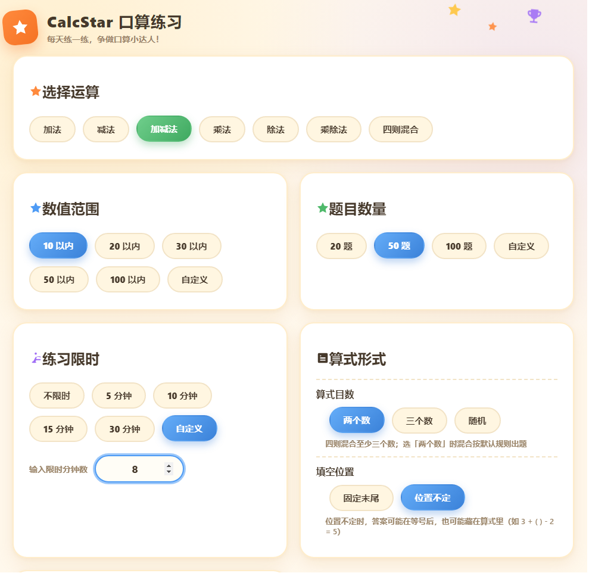
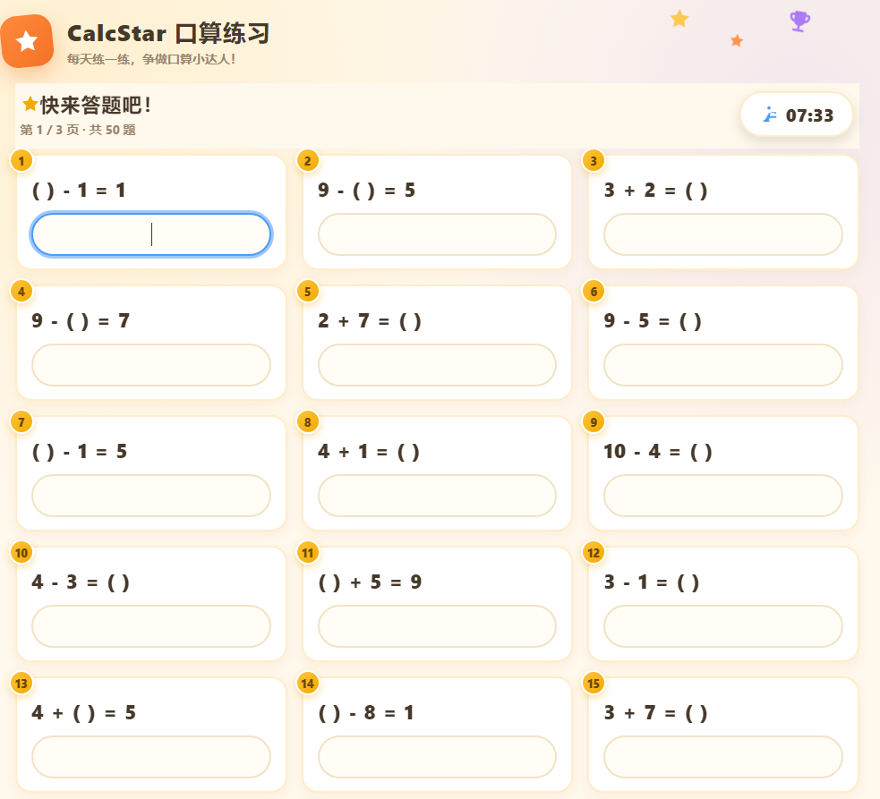
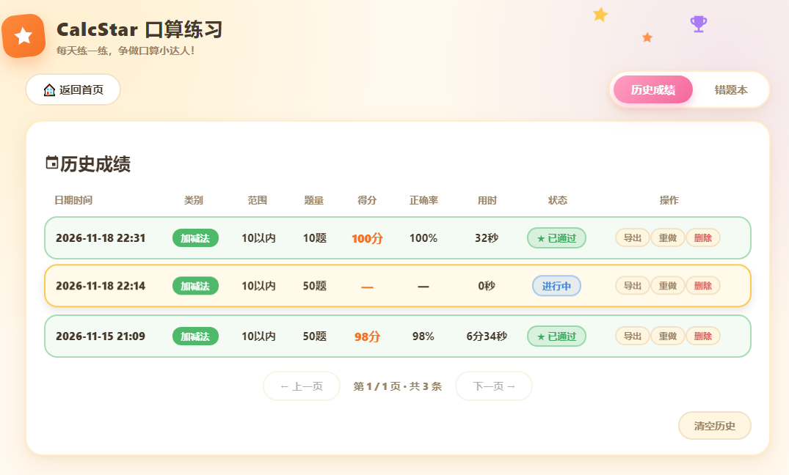
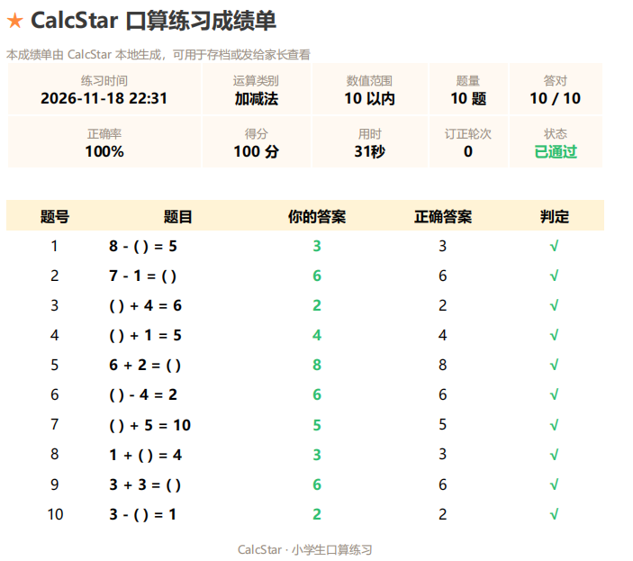

# CalcStar ⭐

一个为小学生打造的四则混合运算练习桌面应用。双击即用、离线运行、界面活泼，让孩子在闯关式的"做题 → 订正 → 全对通过"闭环中练好口算。

## 特性

- **七类运算自由配**：加法 / 减法 / 加减法 / 乘法 / 除法 / 乘除法 / 四则混合运算
- **难度可控**：数值范围预设 10/20/30/50/100 或自定义（1–999）、题量预设 20/50/100 或自定义（1–200）、每页题数 5/10/20、四则混合可选括号、允许负数
- **算式形式可选**：算式目数（两个数 / 三个数 / 四个数 / 自定义 2–10 / 随机 2、3、4；多目链式从左到右求值）、填空位置（固定末尾 `6 + 4 = ( )`、固定在算式中 `6 + ( ) = 9`、两种随机）；无论空在中间还是末尾，统一用括号 `( )` 占位
- **限时挑战**：不限时 / 5/10/15/30 分钟或自定义时长，倒计时归零自动交卷；不限时则正向计时
- **顺手做题**：题目大网格分页展示、翻页答案保留；输入合法答案自动跳下一题，回车 / Tab / 点击卡片任意位置均可移动焦点；未答完提交有提示
- **自动判分订正**：提交即判分（正确数 / 百分制得分 / 正确率 / 用时）；订正只针对本局答错的题，按设置页每页题数分页展示、跨页填写会保留，直到全部答对才算通关并记录订正轮次
- **成绩单导出**：成绩页可选 PDF / PNG 图片，历史每条记录提供 PDF、图片两个导出入口（成绩概览 + 逐题明细，错题标红），导出过程有遮罩提示，离线本地秒级生成
- **错题本**：按"表达式 + 正确答案"聚合错题，累计错误次数，支持类别筛选、按次数 / 最近做错排序、按每页题数分页、单条删除与一键清空（均需二次确认），并可一键重练
- **历史成绩**：每次练习的时间、类别、范围、题量、用时、得分、通过状态全部留档，可查看逐题明细；每条记录支持导出成绩单、一键重做（按原设置含算式形式重新出题）与删除（二次确认），也可一键清空全部历史（错题本保留）
- **设置自动记忆**：所有设置在开始练习时自动保存，下次启动直接沿用
- **数据本地化**：SQLite 存储，数据不出机器

## 界面截图

**设置页：运算类别、数值范围、题量、限时与算式形式**



**练习页：网格答题、分页与倒计时**



**历史成绩：明细查看、导出、重做与删除**



**成绩页：得分、正确率与用时**


**导出的成绩单（PDF / PNG 图片）**



## 技术栈

| 层 | 技术 |
|---|---|
| 桌面壳 | Python 3.11+（开发环境 3.13）+ PyQt5 / PyQtWebEngine（内置 Chromium，无需浏览器或 WebView2） |
| 前后端通信 | QWebChannel 桥接，无 HTTP、无端口 |
| 前端 | 原生 HTML / CSS / JS，儿童活泼风设计系统 |
| 前端测试 | Jest + jsdom（`js_tests/`），与 pytest 一同作为打包门禁 |
| 持久化 | SQLite |
| 构建 | pyproject.toml（src 布局）+ PyInstaller 打包（默认目录模式，可选单文件） |

## 快速开始（开发）

```powershell
# 1. 创建并激活虚拟环境
python -m venv .venv
.\.venv\Scripts\Activate.ps1

# 2. 安装项目与开发依赖
pip install -e .[dev]

# 3. 启动应用
calcstar          # 或 python -m calcstar

# 4. 运行测试（覆盖率阈值 85% 已写入 pyproject.toml）
pytest              # 后端：当前 215 例全绿，覆盖率 89.74%

# 5. 运行前端测试（Jest + jsdom，首次需 npm ci 安装依赖）
cd js_tests
npm ci
npm test            # 当前 11 套件 / 65 例全绿
```

`build.ps1` 打包前会依次运行 pytest 与 Jest 双门禁；如仅需快速打包可加 `-SkipTests` 跳过。

## 打包发布

```powershell
.\build.ps1                  # 默认目录模式：产出 dist\CalcStar\CalcStar.exe，双击即可运行
.\build.ps1 -Mode onefile    # 单文件模式：产出 dist\CalcStar.exe
.\build.ps1 -Pack            # onedir + NSIS：产出 dist\CalcStar-<version>-Setup.exe
.\build.ps1 -SkipTests       # 跳过打包前的 pytest / Jest 门禁
```

若项目根目录 `.venv` 不存在，`build.ps1` 会自动创建它，并只在该 venv 内安装项目与开发依赖，不会改动全局 Python 环境。

打包内置 Python 运行时、QtWebEngine 内核、全部前端资源与应用图标（星形计算器卡通图标，同时用于窗口与任务栏），目标机器无需安装任何组件。目录模式（默认）启动无需解压临时文件、速度更快，运行时文件放在 `dist\CalcStar\lib\`（PyInstaller 默认的 `_internal` 已改名）；单文件模式便于拷贝分发。`-Pack` 仅适用于 onedir；找不到 `makensis.exe` 时会自动下载 NSIS 便携包（zlib 许可，无商业授权限制）到项目根目录 `.nsis\`（已 gitignore）并校验 SHA256（可用 `-NsisUrl` 换源，或用 `-NsisPath` 指定已有编译器），生成的安装包名为“计算之星”，带开始菜单与桌面快捷方式。面向最终用户的安装与使用说明见 [docs/运行说明.md](docs/运行说明.md)。当前发布版本 `v0.1.1`（对应 Git 标签）。

## 数据存储

数据库位于用户数据目录（Windows：`%APPDATA%\CalcStar\calcstar.db`），可通过环境变量 `CALCSTAR_DB` 自定义路径。

## License

本项目基于 [MIT License](LICENSE) 开源。
